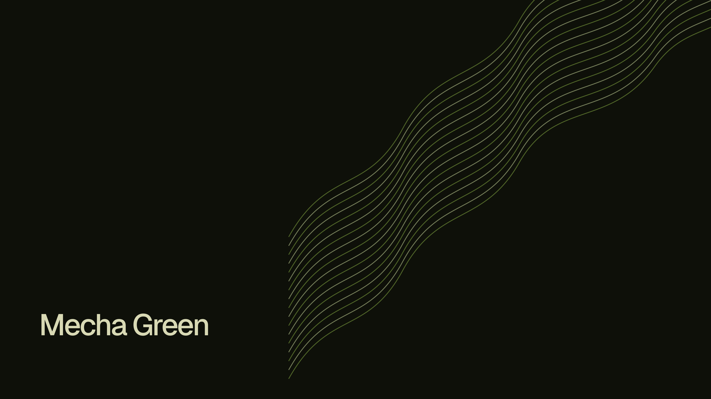
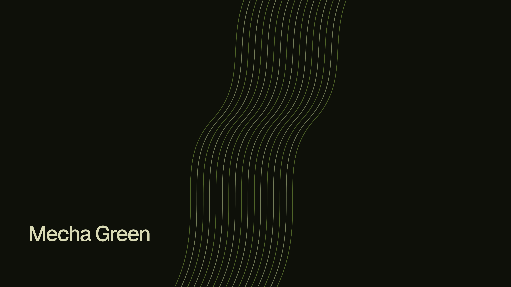
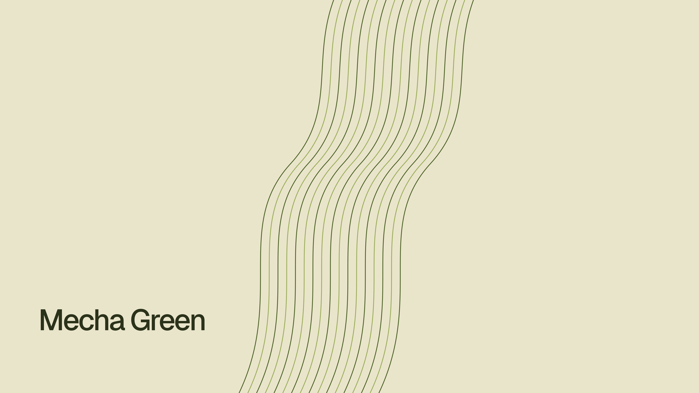
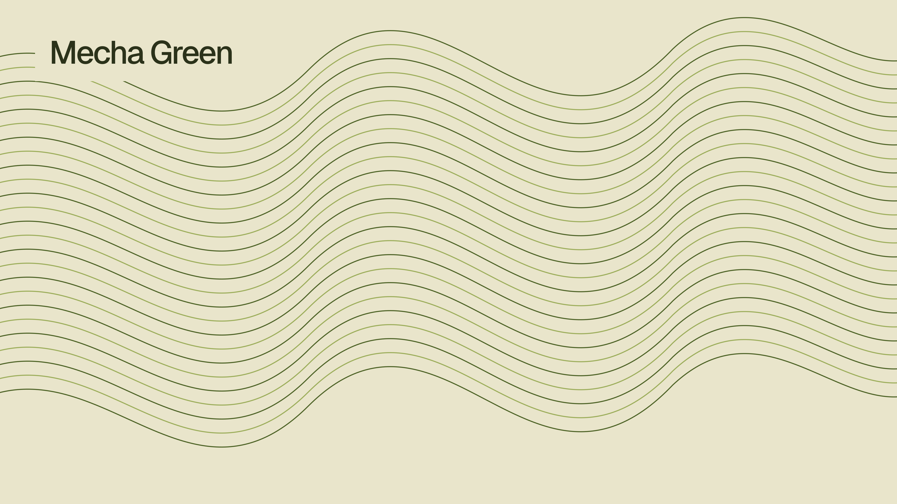
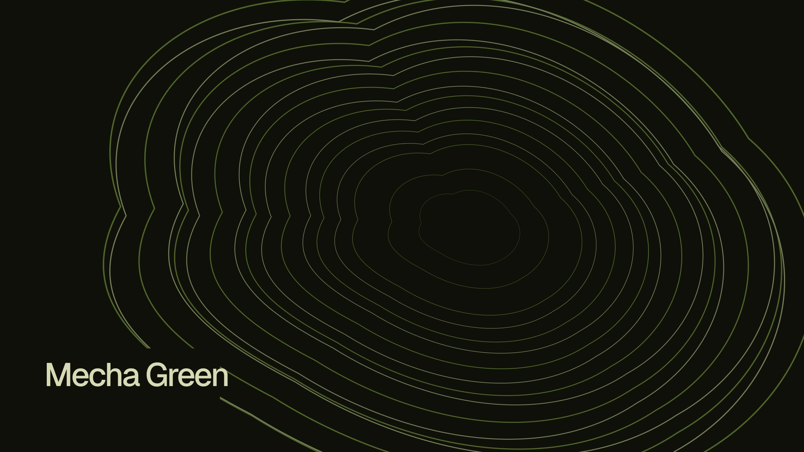
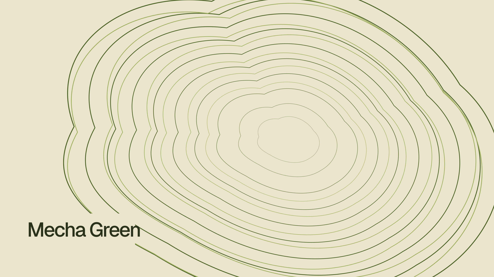
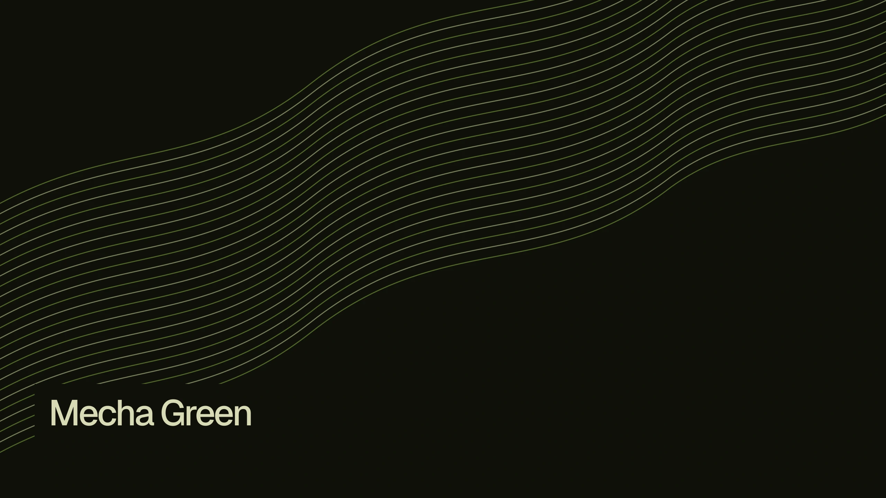
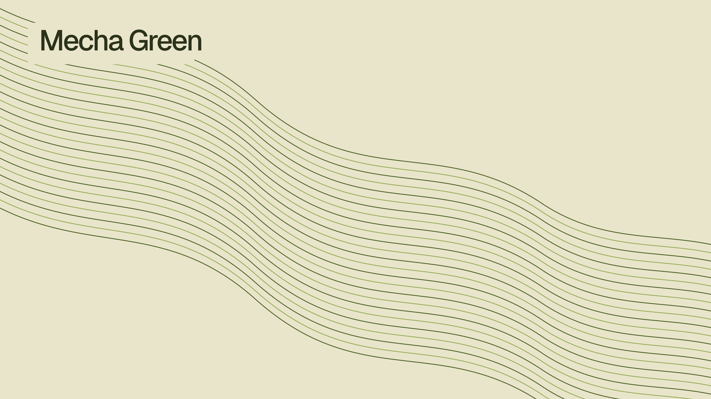

# Mecha Green for Omarchy

**Olive drab, worn steel and Master Chief's amber visor — a dark and a light
Omarchy theme tuned to sit next to an MCHOSE Ace 75 in Mecha Green.**

[](#license)
[](https://omarchy.org/)
[](https://quickshell.org/)
[](https://github.com/sazardev/omarchy-mecha-green/actions/workflows/validate.yml)


## What you get

- **Two complete themes** — `Mecha Green` (dark) and `Mecha Green Light`
  (sand/olive/bronze). Both drive the Omarchy shell, terminals, Neovim, VS
  Code, btop, tmux, gum, fcitx5, Chromium, icons and the Plymouth boot logo.
- **A themed appbar and shell** — `shell.toml` sets an olive-black bar with
  amber indicators, amber-tinted selection, gradient-bordered popups, menus,
  notifications, launcher and lock screen. The light theme flips it to sand
  and bronze.
- **Themed boot, login and lock screens** — the same flat topographic brand on a
  custom Plymouth splash and Mecha Green SDDM login, with the amber Omarchy mark
  and password field. The lock screen inherits the current wallpaper and uses
  the matching amber/sand tokens.
- **Seven flat wallpapers + six live loops per theme** — the `0-topographic`
  brand default plus Drift, Fold, Field, Terrain, Panorama and Undulate. Every
  design has a dark/light still and a clean animated loop with fixed typography.
  The `100-` series avoids collisions with the optional Halo set.
- **Mecha HUD** — a working Quickshell bar plugin: `NET` latency, `THRT` CPU
  load, `AMMO` RAM pressure, optional `PWR` battery. Click for a Halo-style
  command panel with integrity bars, objectives, an animated radar, a
  60-sample latency graph, packet loss, uptime, a ping-target switcher and a
  **NEXT LIVE** control for video wallpapers.
- **Mecha NET** — a compact standalone latency widget if you want only ping.
- **CLI artifacts** — `mecha-status` prints a tactical dashboard in the
  terminal (`--json` and `--watch` included), `mecha-themetize` maps any image
  onto the Mecha Green palette and can install it as a wallpaper, and
  `ping-status` is a Waybar-style command-module script.
- **Standard Omarchy install** — registry-ready dark and light theme
  repositories install with `omarchy theme install mecha-green` (or the light
  twin), while `install.sh` adds the HUD, CLI, login screens and optional sets.
- **Original editable SVG sources** for the full flat topographic collection.

## Boot and login

| | |
|---|---|
| <br>**SDDM login** — Mecha Green system access | <br>**Plymouth boot** — amber Omarchy mark and progress bar |

- **Lock screen:** follows the current wallpaper, blurs it and applies the
  `[lock]` tokens from `shell.toml` — amber border, olive field, rust error
  state.
- **SDDM login:** flat topographic background, Geist typography, amber Omarchy
  mark, password field and multiuser selector.
- **Plymouth boot:** the same flat topographic background with the amber Omarchy
  mark and a matching amber progress bar.

The login and boot themes are system files, so they have their own installer:

```sh
sudo ./system/install-login.sh
```

It backs up the current SDDM/Plymouth config, installs both themes and rebuilds
the initramfs. The login screen appears on the next logout/reboot; the boot
splash on the next boot. Undo with `sudo ./system/uninstall-login.sh`.

## Install

There are two supported paths: the standard Omarchy theme install for the
theme itself, or the full project installer for the HUD, CLI, login screens and
optional wallpaper sets.

### Omarchy theme install (theme only)

The themes live in their own registry-ready repositories:

```sh
# Once the registry listing is live
omarchy theme install mecha-green
omarchy theme install mecha-green-light

# Or install directly from the repositories today
omarchy theme install https://github.com/sazardev/omarchy-mecha-green-theme
omarchy theme install https://github.com/sazardev/omarchy-mecha-green-light-theme
```

This is the standard Omarchy path: it keeps the palette, `shell.toml`, btop,
Chromium, icons, keyboard RGB, unlock art, seven flat wallpapers and six live
loops.
Omarchy regenerates the terminal and Hyprland configs from `colors.toml` and
drops executable theme files, exactly as designed for third-party themes.

### Full setup (recommended for the complete desktop)

```sh
bash -c "$(curl -fsSL https://raw.githubusercontent.com/sazardev/omarchy-mecha-green/main/install.sh)"
```

The full installer copies both themes as user-owned themes, installs the
Mecha HUD and Mecha NET plugins, adds the CLIs, enables the HUD on the right
side of the bar, and applies the dark theme. It also supports the optional
Halo/military sets and the SDDM/Plymouth login screens. It does **not** use
`sudo` for the user setup and backs up `shell.json` before touching the bar.

### From a clone

```sh
git clone https://github.com/sazardev/omarchy-mecha-green.git
cd omarchy-mecha-green
./install.sh
```

### Options

| Flag | What it does |
|---|---|
| `--light` | Apply **Mecha Green Light** instead of the dark theme |
| `--no-apply` | Install everything but keep the current theme |
| `--no-hud` | Do not enable the Mecha HUD bar widget |
| `--ping` | Also enable the standalone **Mecha NET** widget |
| `--halo` | Download all optional Halo & military sets: 34 dark / 30 light stills (personal use only) |
| `--halo-live` | Also build the 7 dark / 5 light Halo live loops (implies `--halo`) |
| `--bar <mode>` | Bar background: `opaque` (default), `glassy` or `none` |
| `--no-bar` | Leave the current bar background mode alone |
| `--force` | Overwrite existing backgrounds and previews |
| `--dry-run` | Show what would be installed |

Examples:

```sh
./install.sh --light --halo
./install.sh --no-hud
./install.sh --ping --halo
```

> **Why not `omarchy theme install`?** This repository ships **two** themes plus
> plugins and a custom `hyprland.lua` / Alacritty config. Omarchy's repo-theme
> installer expects a single theme at the repository root and, by design, drops
> Lua and terminal files from cloned themes. `install.sh` copies the folders as
> user-owned themes, so everything works. The manual copy path is documented in
> [`docs/INSTALL.md`](docs/INSTALL.md).

### Requirements

- Omarchy with Hyprland + Quickshell (current Quattro).
- `git` or `curl` for the installer.
- `ping` from `iputils` for the NET/HUD widgets.
- ImageMagick (`magick`) if you use `--halo`, `mecha-fetch-halo` or the
  filter in `mecha-livewall`.
- `ffmpeg` for live wallpaper generation and the optional Halo live set.

## Use

```sh
omarchy theme set "Mecha Green"        # dark
omarchy theme set "Mecha Green Light"  # light
omarchy theme bg next                  # cycle the installed wallpapers

omarchy bar background opaque          # solid olive bar (the recommended look)
omarchy bar background glassy          # translucent
omarchy bar background none            # transparent, wallpaper only
```

The Mecha HUD is placed at the far right of the bar after `omarchy.power`:

```sh
omarchy plugin enable sazardev.mecha-hud --section right --after omarchy.power
```

Prefer only latency? Enable the compact NET widget:

```sh
omarchy plugin enable sazardev.ping --section right --after omarchy.network
```

## The Mecha HUD

The bar strip is three (or four) military readouts:

| Block | Meaning | Colour rule |
|---|---|---|
| `NET` | ICMP latency to the selected host | amber < 40 ms, sage < 100 ms, rust otherwise |
| `THRT` | CPU load | amber < 40%, sage < 70%, rust above |
| `AMMO` | RAM pressure, styled as ammunition | amber < 60%, sage < 85%, rust above |
| `PWR` | Battery percentage, shown only when a battery exists | amber charging, sage healthy, rust low |

Interactions:

- **Left click** — open the Mecha Command panel.
- **Middle click** — refresh every sample immediately.
- **Right click** — cycle the ping target: Cloudflare → Google → local gateway.
- Hover for a one-line tactical tooltip.

The panel is laid out like a Halo military menu:

- Integrity bars for `UPLINK`, `CORE`, `AMMO` and optional `POWER`.
- An objectives list with live `SECURE` / `GUARDED` / `LOW` states.
- An animated radar with contact blips.
- Telemetry cards for NET, THREAT, AMMO, SHIELD, PACKET and MISSION.
- A 60-sample latency graph with packet-loss gaps.
- Per-sample packet loss and session sample count.
- A ping-target switcher that persists your choice in `shell.json`.
- **NEXT LIVE** — cycles video wallpapers only, using `mecha-live-next`.

Settings can also be changed from the shell:

```sh
omarchy bar set sazardev.mecha-hud pingHost 8.8.8.8
omarchy bar set sazardev.mecha-hud pingIntervalSec 5
```

Available keys: `pingHost` (string), `pingIntervalSec` (2–60), `showCpu`,
`showAmmo`, `showPower` (booleans).

## Tactical CLI

`mecha-status` is installed into `~/.local/bin`:

```sh
mecha-status                 # text HUD
mecha-status --json          # machine-readable
mecha-status --watch         # refresh every 2 s
mecha-status 8.8.8.8         # choose a ping host
```

```
  MECHA GREEN  //  TACTICAL STATUS  //  117
  ──────────────────────────────────────────────
  NET     045 ms    1.1.1.1
  THREAT    3 %      LOW
  AMMO     50 %      7.7 / 15.5 GB
  PWR     AC
  MISSION 0d 01:08
  LINK    192.168.1.254 via wlp7s0
  ──────────────────────────────────────────────
```

`ping-status` prints Waybar-style JSON for Omarchy's built-in
`type: "command"` bar modules. See [`docs/INSTALL.md`](docs/INSTALL.md#use-the-built-in-command-module)
for the `shell.json` snippet.

## Themetize any image

`mecha-themetize` maps any image onto the Mecha Green olive/amber palette with
a luminance gradient and keeps a configurable amount of the original colour.

```sh
# Dark theme, 2560×1440 WebP next to the input
mecha-themetize ~/Pictures/wallpaper.jpg

# Both themes, auto-numbered into the installed theme folders
mecha-themetize ~/Pictures/wallpaper.jpg --mode both --install --name my-wallpaper

# Light theme, keep more of the original colour
mecha-themetize artwork.png /tmp/art.webp --mode light --keep-color 30

# No crop, full original composition
mecha-themetize photo.jpg --fit none
```

Options: `--mode dark|light|both`, `--strength 0-100`, `--keep-color 0-100`,
`--fit WxH|none`, `--name`, `--install`, `--force`, `--vignette`, `--grain`.

`--install` finds the next free `NN-name.webp` in
`~/.config/omarchy/themes/mecha-green/backgrounds/` (or the light twin) and
refreshes the background cache.

## Palette

### Mecha Green (dark)

| Role | Hex |
|---|---|
| Background | `#0E1009` |
| Raised surface | `#11150B` |
| Military olive | `#9DAE5C` |
| Visor amber / accent | `#F2C84B` |
| Sand text | `#D8D9B4` |
| Sage | `#BCC09A` |
| Rust | `#C85B47` |
| HUD teal | `#7FA89A` |

The Hyprland border is a 45° amber → olive → amber gradient.

### Mecha Green Light

| Role | Hex |
|---|---|
| Sand background | `#E9E5CB` |
| Raised surface | `#F1EEDA` |
| Olive | `#4F6428` |
| Bronze / accent | `#7D5200` |
| Dark olive ink | `#2B321A` |
| Rust | `#9C3F2D` |
| Deep patina | `#2F6A5E` |

## Bundled wallpapers

Each theme ships seven original 2560×1440 flat stills and six original live
loops. `0-topographic` stays first alphabetically and remains the default.

| Art | Dark | Light |
|---|---|---|
| Default wave |  |  |
| Drift |  |  |
| Fold |  |  |
| Field |  |  |
| Terrain |  |  |
| Panorama |  |  |
| Undulate |  |  |

Editable SVG sources live in `assets/svg/` and
`proposals/backgrounds/svg/`. Regenerate the stills and previews with:

```sh
./scripts/render-wallpapers.sh
```

## Bundled live wallpapers

Each design has an 8-second H.264 loop at 2560×1440 and 24 fps. Only the contour
lines move; the Geist wordmark stays fixed. No noise, HUD, glow, gradients or
shadows are added.

| Loop | Dark | Light |
|---|---|---|
| Drift | `100-drift.mp4` | `100-drift-light.mp4` |
| Fold | `101-fold.mp4` | `101-fold-light.mp4` |
| Field | `102-field.mp4` | `102-field-light.mp4` |
| Terrain | `103-terrain.mp4` | `103-terrain-light.mp4` |
| Panorama | `104-panorama.mp4` | `104-panorama-light.mp4` |
| Undulate | `105-undulate.mp4` | `105-undulate-light.mp4` |

Regenerate the loops with `python3 proposals/backgrounds/generate-live.py`.
For additional Halo live wallpapers, fetch the Halo stills and build the curated loops:

```sh
./scripts/fetch-halo-backgrounds.sh
mecha-live-set                    # 7 dark / 5 light loops
mecha-live-next                   # next video only
```

`mecha-livewall` turns any image into a filtered loop:

```sh
mecha-livewall photo.jpg --style command --install
mecha-livewall art.png --mode both --style rain --install --name my-wall
```

Styles: `command`, `rain`, `dust`, `pulse`, `storm` and `radar`. The full
guide is in [`docs/LIVE_WALLPAPERS.md`](docs/LIVE_WALLPAPERS.md).

## Wallpapers & licensing

The repository bundles seven original flat stills and six original live loops
per theme:

- `0-topographic*.webp` — the default brand wave.
- `100-drift*` through `105-undulate*` — six additional topographic designs.
- Matching `.mp4` loops with animated lines and fixed typography.

These are licensed MIT together with the theme code.

The **Halo & military wallpaper set is not bundled**. It is fan /
© Microsoft–343 Industries / third-party artwork from Wallhaven, and remains
the property of its respective owners. The optional fetcher downloads, crops
and grades it for personal desktop use:

```sh
mecha-fetch-halo
# or
./scripts/fetch-halo-backgrounds.sh
```

See [`docs/WALLPAPERS.md`](docs/WALLPAPERS.md) for the full credits and notes.

**Halo, Master Chief, MCHOSE and Omarchy are trademarks of their respective
owners. This is a personal fan theme, not affiliated with or endorsed by
Microsoft, 343 Industries, MCHOSE or Omarchy.**

## Customize

- Palette: edit `themes/mecha-green/colors.toml` (and the light twin), then
  `omarchy theme set "Mecha Green"` to regenerate the rest.
- Shell surfaces: edit `shell.toml` — bar background, sizes, selection,
  popups, notifications, launcher, lock, tooltips.
- Plugin: `omarchy bar set sazardev.mecha-hud <key> <value>`.
- More wallpapers: drop files into
  `~/.config/omarchy/themes/mecha-green/backgrounds/` and run
  `omarchy theme bg next`.
- The original SVG sources live in `assets/svg/topo-dark.svg` and
  `assets/svg/topo-light.svg` if you want to remix the wallpaper.

More in [`docs/CUSTOMIZE.md`](docs/CUSTOMIZE.md).

## Uninstall

```sh
./uninstall.sh
```

It removes both themes, both plugins and the CLI. Switch to another theme
before removing them.

## License

MIT for the theme configuration, plugins, scripts and original artwork. See
[`LICENSE`](LICENSE).

The Halo artwork is **not** included in the MIT grant and is never bundled in
this repository. If you fetch it, it is for personal desktop use only.

---

Made for Omarchy, olive keyboards and quiet amber HUDs.
