# Mecha Green for Omarchy

**Olive drab, worn steel and Master Chief's amber visor — a dark and a light
Omarchy theme tuned to sit next to an MCHOSE Ace 75 in Mecha Green.**

[](#license)
[](https://omarchy.org/)
[](https://quickshell.org/)
[](https://github.com/sazardev/omarchy-mecha-green/actions/workflows/validate.yml)

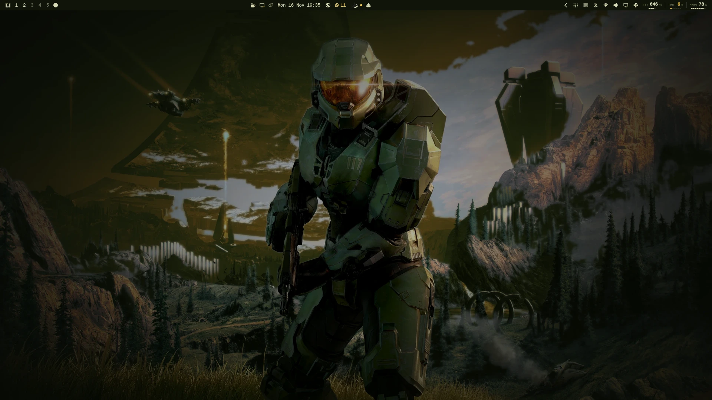
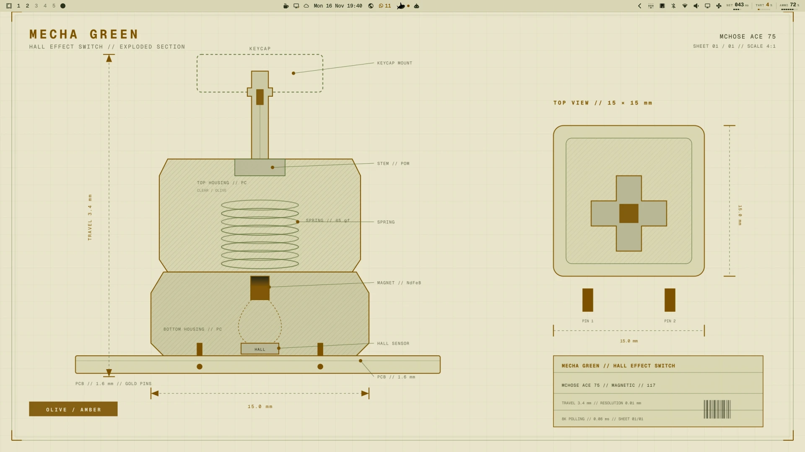

## What you get

- **Two complete themes** — `Mecha Green` (dark) and `Mecha Green Light`
  (sand/olive/bronze). Both drive the Omarchy shell, terminals, Neovim, VS
  Code, btop, tmux, gum, fcitx5, Chromium, icons and the Plymouth boot logo.
- **A themed appbar and shell** — `shell.toml` sets an olive-black bar with
  amber indicators, amber-tinted selection, gradient-bordered popups, menus,
  notifications, launcher and lock screen. The light theme flips it to sand
  and bronze.
- **Themed boot, login and lock screens** — a custom Plymouth splash with an
  amber Omarchy mark and progress bar, a Mecha Green SDDM login with HUD
  background and amber password field, and a lock screen that blurs the
  current wallpaper and uses the same amber/sand lock tokens.
- **42 dark / 38 light stills + live loops** — the repo bundles eight original
  Mecha Green stills and two original live loops in each theme (helmet,
  topographic HUD, keyboard, switch blueprint, PCB blueprint, tactical radar,
  helmet schematic, supply crate, helmet feed, radar sweep). An optional
  fetcher adds thirty-four dark and thirty light Halo & military stills plus
  seven dark and five light live loops for personal use, all graded into
  olive / amber / cream. Curated sets: Spartans, UNSC, Covenant and Forerunner.
- **Mecha HUD** — a working Quickshell bar plugin: `NET` latency, `THRT` CPU
  load, `AMMO` RAM pressure, optional `PWR` battery. Click for a Halo-style
  command panel with integrity bars, objectives, an animated radar, a
  60-sample latency graph, packet loss, uptime, a ping-target switcher and a
  **NEXT LIVE** control for video wallpapers.
- **Mecha NET** — a compact standalone latency widget if you want only ping.
- **CLI artifacts** — `mecha-status` prints a tactical dashboard in the
  terminal (`--json` and `--watch` included), `mecha-themetize` maps any image
  onto the Mecha Green palette and can install it as a wallpaper, and
  `ping-status` is a Waybar-style command-module script.
- **Standard Omarchy install** — registry-ready dark and light theme
  repositories install with `omarchy theme install mecha-green` (or the light
  twin), while `install.sh` adds the HUD, CLI, login screens and optional sets.
- **Original SVG sources** for the helmet, topographic and keyboard art.

## Real screenshots

Captured on the author's Omarchy desktop at 1920×1080: the bar, the Mecha HUD,
the themed terminal, btop, the keyboard wallpaper and the light variant.

| | |
|---|---|
| 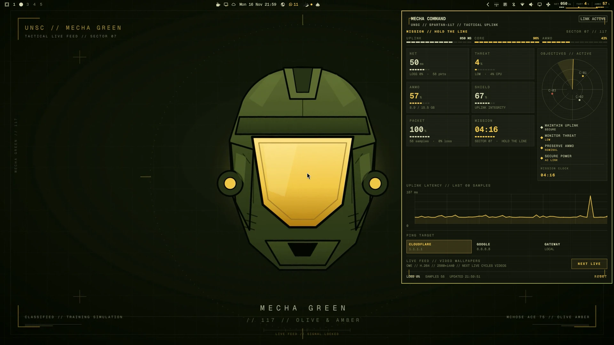<br>**Mecha Command panel** — over the live helmet feed | 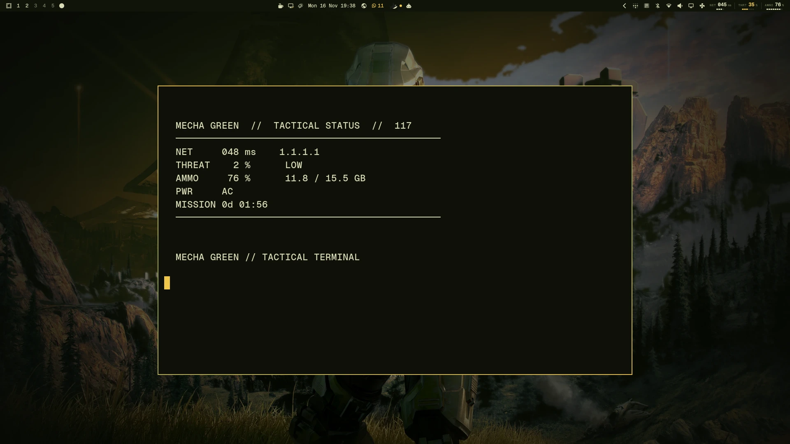<br>**Mecha status** — the tactical terminal |
| 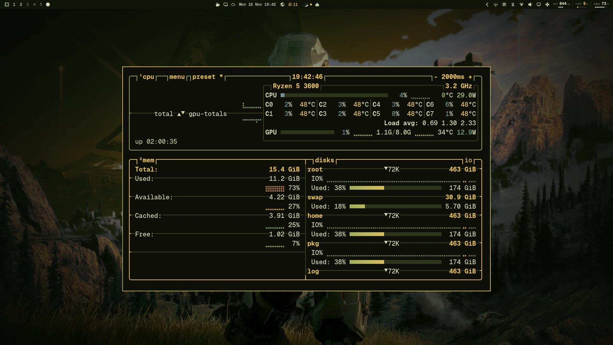<br>**btop dark** — olive/amber CPU and memory | 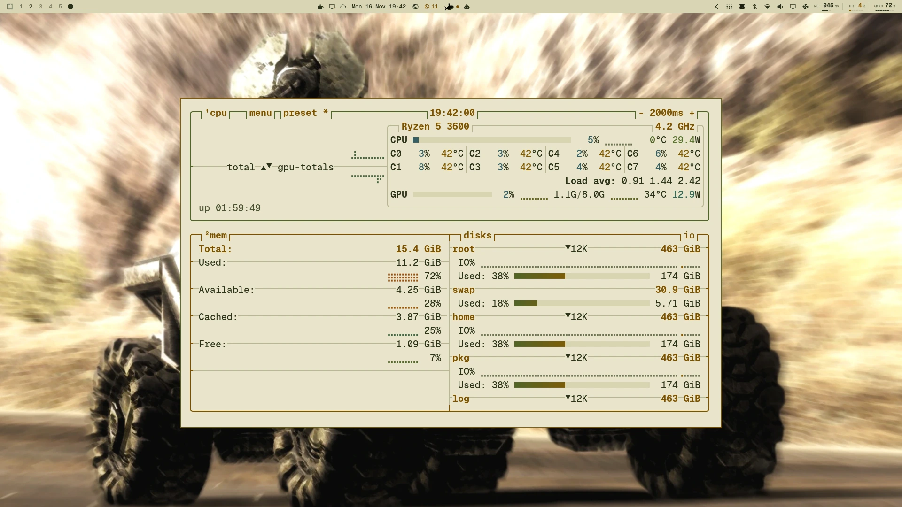<br>**btop light** — sand/bronze |
| 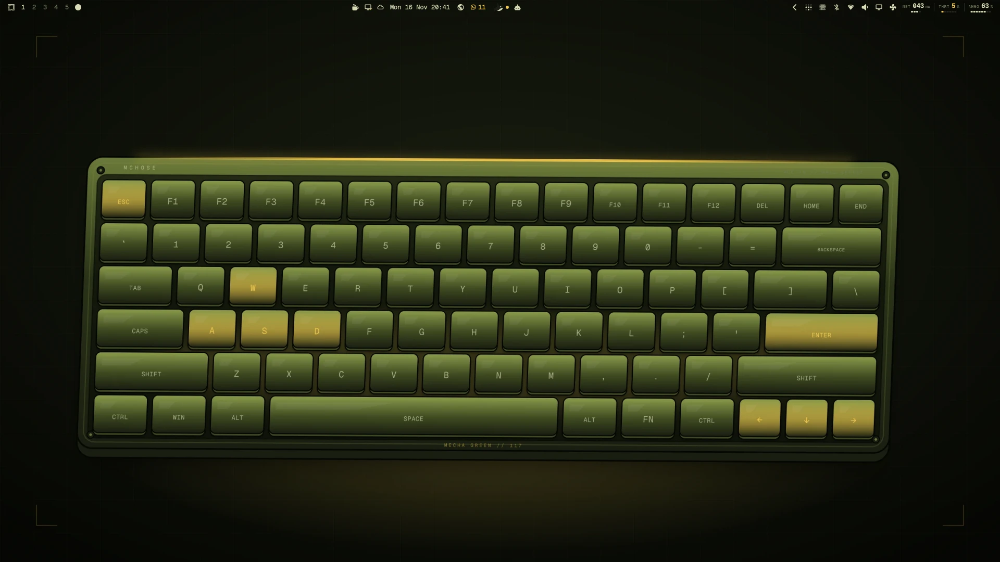<br>**Keyboard wallpaper** — product-style MCHOSE Ace 75 | 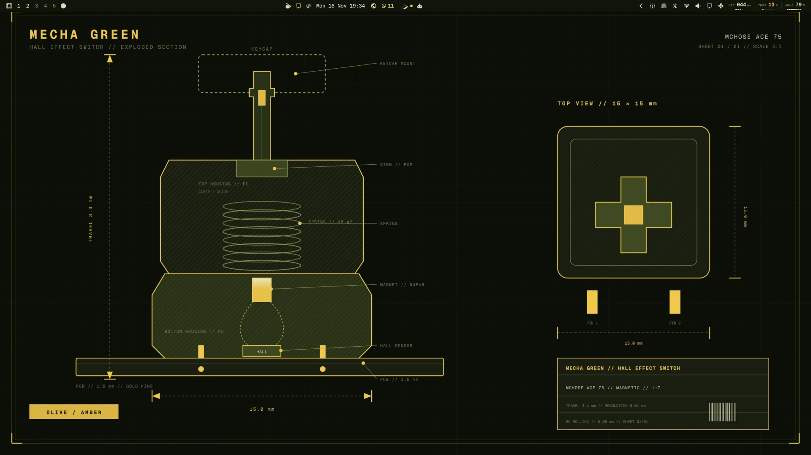<br>**Switch blueprint desktop** — clean |
| 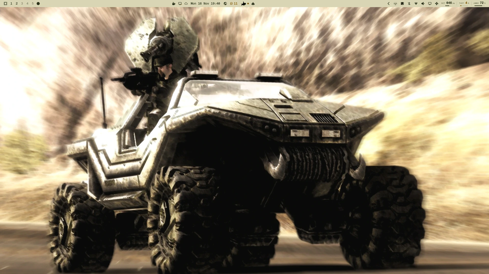<br>**Light Warthog desktop** — warm Halo scene | <br>**Light switch blueprint** — sand/bronze desktop |

## Boot, login and lock

| | |
|---|---|
| 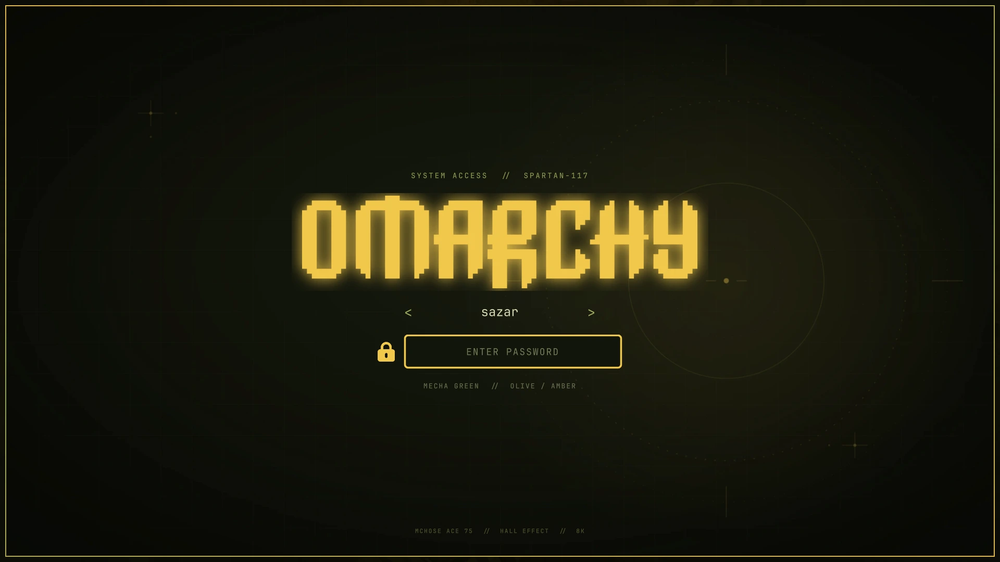<br>**SDDM login** — Mecha Green system access | <br>**Plymouth boot** — amber Omarchy mark and progress bar |
| 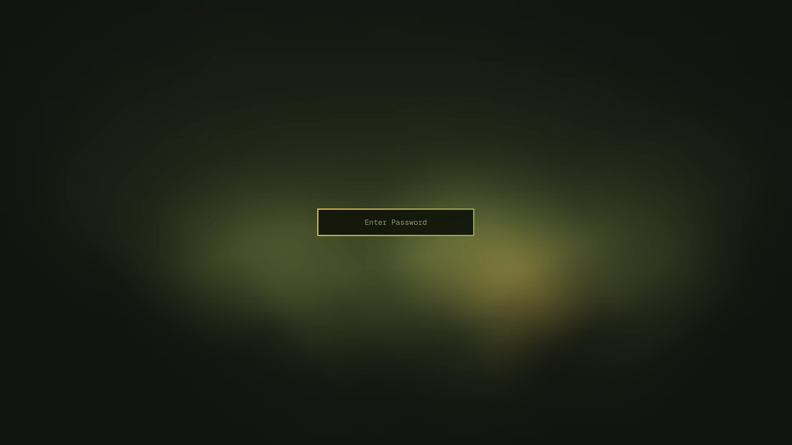<br>**Lock screen dark** — blurred Mecha Green wallpaper | 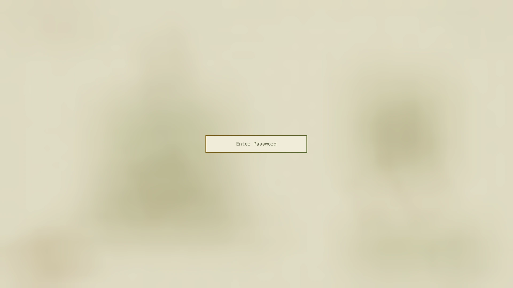<br>**Lock screen light** — sand and bronze |

- **Lock screen:** follows the current wallpaper, blurs it and applies the
  `[lock]` tokens from `shell.toml` — amber border, olive field, rust error
  state.
- **SDDM login:** dark olive HUD background, amber Omarchy mark, amber
  password field, multiuser selector.
- **Plymouth boot:** custom dark-olive theme with the amber Omarchy mark and a
  matching amber progress bar.

The login and boot themes are system files, so they have their own installer:

```sh
sudo ./system/install-login.sh
```

It backs up the current SDDM/Plymouth config, installs both themes and rebuilds
the initramfs. The login screen appears on the next logout/reboot; the boot
splash on the next boot. Undo with `sudo ./system/uninstall-login.sh`.

## Custom hardware art

The bundled set includes five code-drawn military pieces. A few highlights:

| | |
|---|---|
| 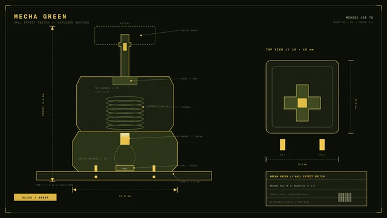<br>**Hall Effect switch** — cross-section, spring, magnet and Hall sensor | <br>**PCB / switch matrix** — 75% matrix and switch footprint |
| 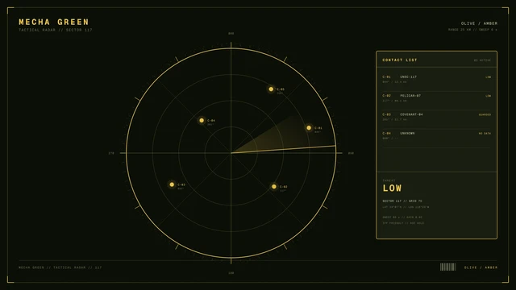<br>**Tactical radar** — contacts, sweep and threat readout | 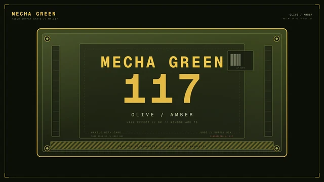<br>**Supply crate** — stencil, hazard strip and lot marks |

## Install

There are two supported paths: the standard Omarchy theme install for the
theme itself, or the full project installer for the HUD, CLI, login screens and
optional wallpaper sets.

### Omarchy theme install (theme only)

The themes live in their own registry-ready repositories:

```sh
# Once the registry listing is live
omarchy theme install mecha-green
omarchy theme install mecha-green-light

# Or install directly from the repositories today
omarchy theme install https://github.com/sazardev/omarchy-mecha-green-theme
omarchy theme install https://github.com/sazardev/omarchy-mecha-green-light-theme
```

This is the standard Omarchy path: it keeps the palette, `shell.toml`, btop,
Chromium, icons, keyboard RGB, unlock art, the eight original stills and the
two bundled live loops.
Omarchy regenerates the terminal and Hyprland configs from `colors.toml` and
drops executable theme files, exactly as designed for third-party themes.

### Full setup (recommended for the complete desktop)

```sh
bash -c "$(curl -fsSL https://raw.githubusercontent.com/sazardev/omarchy-mecha-green/main/install.sh)"
```

The full installer copies both themes as user-owned themes, installs the
Mecha HUD and Mecha NET plugins, adds the CLIs, enables the HUD on the right
side of the bar, and applies the dark theme. It also supports the optional
Halo/military sets and the SDDM/Plymouth login screens. It does **not** use
`sudo` for the user setup and backs up `shell.json` before touching the bar.

### From a clone

```sh
git clone https://github.com/sazardev/omarchy-mecha-green.git
cd omarchy-mecha-green
./install.sh
```

### Options

| Flag | What it does |
|---|---|
| `--light` | Apply **Mecha Green Light** instead of the dark theme |
| `--no-apply` | Install everything but keep the current theme |
| `--no-hud` | Do not enable the Mecha HUD bar widget |
| `--ping` | Also enable the standalone **Mecha NET** widget |
| `--halo` | Download all optional Halo & military sets: 34 dark / 30 light stills (personal use only) |
| `--halo-live` | Also build the 7 dark / 5 light Halo live loops (implies `--halo`) |
| `--bar <mode>` | Bar background: `opaque` (default), `glassy` or `none` |
| `--no-bar` | Leave the current bar background mode alone |
| `--force` | Overwrite existing backgrounds and previews |
| `--dry-run` | Show what would be installed |

Examples:

```sh
./install.sh --light --halo
./install.sh --no-hud
./install.sh --ping --halo
```

> **Why not `omarchy theme install`?** This repository ships **two** themes plus
> plugins and a custom `hyprland.lua` / Alacritty config. Omarchy's repo-theme
> installer expects a single theme at the repository root and, by design, drops
> Lua and terminal files from cloned themes. `install.sh` copies the folders as
> user-owned themes, so everything works. The manual copy path is documented in
> [`docs/INSTALL.md`](docs/INSTALL.md).

### Requirements

- Omarchy with Hyprland + Quickshell (current Quattro).
- `git` or `curl` for the installer.
- `ping` from `iputils` for the NET/HUD widgets.
- ImageMagick (`magick`) if you use `--halo`, `mecha-fetch-halo` or the
  filter in `mecha-livewall`.
- `ffmpeg` for live wallpaper generation and the optional Halo live set.

## Use

```sh
omarchy theme set "Mecha Green"        # dark
omarchy theme set "Mecha Green Light"  # light
omarchy theme bg next                  # cycle the installed wallpapers

omarchy bar background opaque          # solid olive bar (the recommended look)
omarchy bar background glassy          # translucent
omarchy bar background none            # transparent, wallpaper only
```

The Mecha HUD is placed at the far right of the bar after `omarchy.power`:

```sh
omarchy plugin enable sazardev.mecha-hud --section right --after omarchy.power
```

Prefer only latency? Enable the compact NET widget:

```sh
omarchy plugin enable sazardev.ping --section right --after omarchy.network
```

## The Mecha HUD

| | |
|---|---|
| <br>**Mecha Command — dark** | 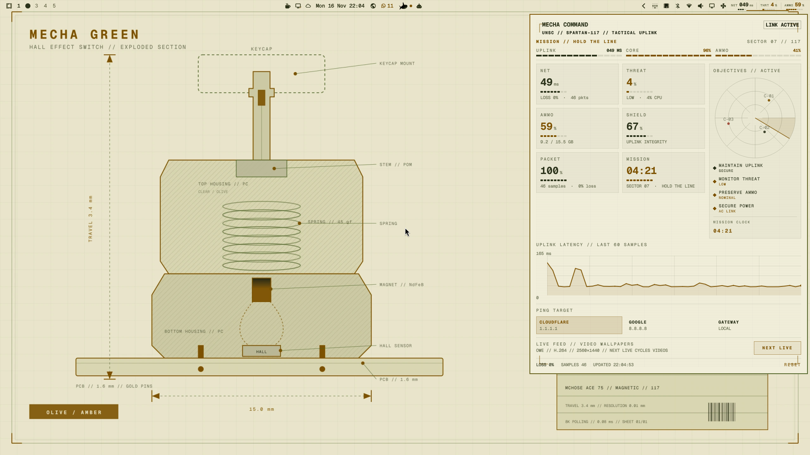<br>**Mecha Command — light** |

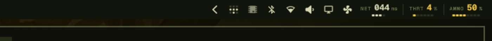

The bar strip is three (or four) military readouts:

| Block | Meaning | Colour rule |
|---|---|---|
| `NET` | ICMP latency to the selected host | amber < 40 ms, sage < 100 ms, rust otherwise |
| `THRT` | CPU load | amber < 40%, sage < 70%, rust above |
| `AMMO` | RAM pressure, styled as ammunition | amber < 60%, sage < 85%, rust above |
| `PWR` | Battery percentage, shown only when a battery exists | amber charging, sage healthy, rust low |

Interactions:

- **Left click** — open the Mecha Command panel.
- **Middle click** — refresh every sample immediately.
- **Right click** — cycle the ping target: Cloudflare → Google → local gateway.
- Hover for a one-line tactical tooltip.

The panel is laid out like a Halo military menu:

- Integrity bars for `UPLINK`, `CORE`, `AMMO` and optional `POWER`.
- An objectives list with live `SECURE` / `GUARDED` / `LOW` states.
- An animated radar with contact blips.
- Telemetry cards for NET, THREAT, AMMO, SHIELD, PACKET and MISSION.
- A 60-sample latency graph with packet-loss gaps.
- Per-sample packet loss and session sample count.
- A ping-target switcher that persists your choice in `shell.json`.
- **NEXT LIVE** — cycles video wallpapers only, using `mecha-live-next`.

Settings can also be changed from the shell:

```sh
omarchy bar set sazardev.mecha-hud pingHost 8.8.8.8
omarchy bar set sazardev.mecha-hud pingIntervalSec 5
```

Available keys: `pingHost` (string), `pingIntervalSec` (2–60), `showCpu`,
`showAmmo`, `showPower` (booleans).

## Tactical CLI

`mecha-status` is installed into `~/.local/bin`:

```sh
mecha-status                 # text HUD
mecha-status --json          # machine-readable
mecha-status --watch         # refresh every 2 s
mecha-status 8.8.8.8         # choose a ping host
```

```
  MECHA GREEN  //  TACTICAL STATUS  //  117
  ──────────────────────────────────────────────
  NET     045 ms    1.1.1.1
  THREAT    3 %      LOW
  AMMO     50 %      7.7 / 15.5 GB
  PWR     AC
  MISSION 0d 01:08
  LINK    192.168.1.254 via wlp7s0
  ──────────────────────────────────────────────
```

`ping-status` prints Waybar-style JSON for Omarchy's built-in
`type: "command"` bar modules. See [`docs/INSTALL.md`](docs/INSTALL.md#use-the-built-in-command-module)
for the `shell.json` snippet.

## Themetize any image

`mecha-themetize` maps any image onto the Mecha Green olive/amber palette with
a luminance gradient and keeps a configurable amount of the original colour.

```sh
# Dark theme, 2560×1440 WebP next to the input
mecha-themetize ~/Pictures/wallpaper.jpg

# Both themes, auto-numbered into the installed theme folders
mecha-themetize ~/Pictures/wallpaper.jpg --mode both --install --name my-wallpaper

# Light theme, keep more of the original colour
mecha-themetize artwork.png /tmp/art.webp --mode light --keep-color 30

# No crop, full original composition
mecha-themetize photo.jpg --fit none
```

Options: `--mode dark|light|both`, `--strength 0-100`, `--keep-color 0-100`,
`--fit WxH|none`, `--name`, `--install`, `--force`, `--vignette`, `--grain`.

`--install` finds the next free `NN-name.webp` in
`~/.config/omarchy/themes/mecha-green/backgrounds/` (or the light twin) and
refreshes the background cache.

## Palette

### Mecha Green (dark)

| Role | Hex |
|---|---|
| Background | `#0E1009` |
| Raised surface | `#11150B` |
| Military olive | `#9DAE5C` |
| Visor amber / accent | `#F2C84B` |
| Sand text | `#D8D9B4` |
| Sage | `#BCC09A` |
| Rust | `#C85B47` |
| HUD teal | `#7FA89A` |

The Hyprland border is a 45° amber → olive → amber gradient.

### Mecha Green Light

| Role | Hex |
|---|---|
| Sand background | `#E9E5CB` |
| Raised surface | `#F1EEDA` |
| Olive | `#4F6428` |
| Bronze / accent | `#7D5200` |
| Dark olive ink | `#2B321A` |
| Rust | `#9C3F2D` |
| Deep patina | `#2F6A5E` |

## Bundled wallpapers

Each theme ships eight original 2560×1440 stills plus two original live loops.
The optional Halo & military fetcher adds thirty-four dark and thirty light
stills on top, grouped into Spartans, UNSC, Covenant and Forerunner sets, and
can build seven dark / five light live loops from them.

| Art | Dark | Light |
|---|---|---|
| Helmet | 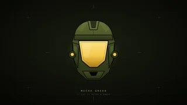 | 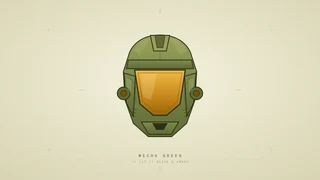 |
| Topographic HUD | 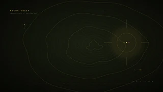 | 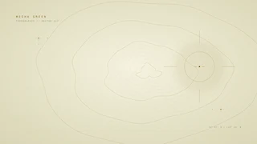 |
| Keyboard |  |  |
| Hall Effect switch | 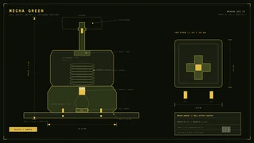 | 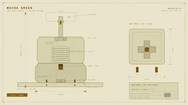 |
| PCB / switch matrix |  |  |
| Tactical radar | 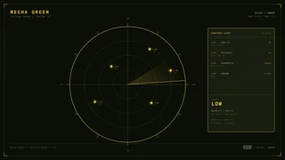 |  |
| Helmet schematic | 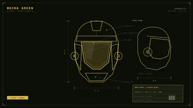 | 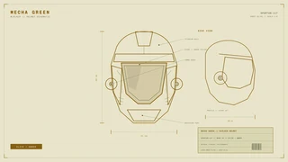 |
| Supply crate |  |  |

## Live wallpapers

The bundled **helmet feed** and **radar sweep** loops play natively through
OWE and cycle with `omarchy theme bg next`. They are silent, 12-second
2560×1440 H.264 loops with scanlines, grain and a military HUD frame.

| | |
|---|---|
| 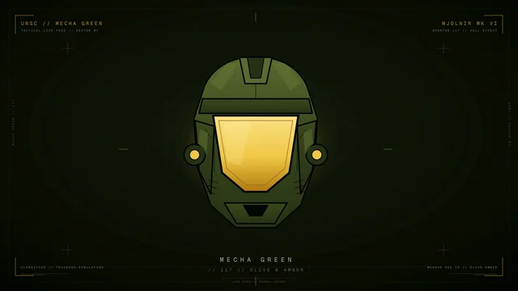<br>**Helmet feed** — dark | 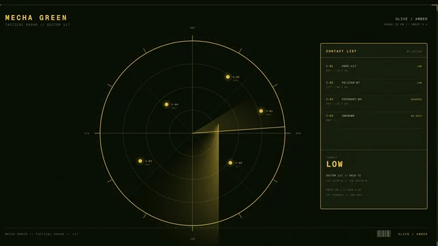<br>**Radar sweep** — dark |
| 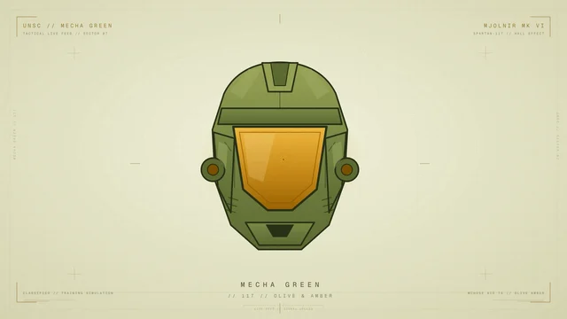<br>**Helmet feed** — light | 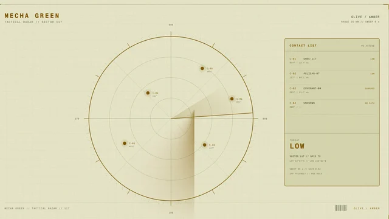<br>**Radar sweep** — light |

For Halo live wallpapers, fetch the Halo stills and build the curated loops:

```sh
./scripts/fetch-halo-backgrounds.sh
mecha-live-set                    # 7 dark / 5 light loops
mecha-live-next                   # next video only
```

`mecha-livewall` turns any image into a filtered loop:

```sh
mecha-livewall photo.jpg --style command --install
mecha-livewall art.png --mode both --style rain --install --name my-wall
```

Styles: `command`, `rain`, `dust`, `pulse`, `storm` and `radar`. The full
guide is in [`docs/LIVE_WALLPAPERS.md`](docs/LIVE_WALLPAPERS.md).

## Wallpapers & licensing

The repository bundles **original** wallpapers and live loops only:

- `8-mecha-helmet.webp` — original vector Spartan helmet.
- `9-topographic.webp` — original topographic HUD.
- `10-keyboard.webp` — original MCHOSE Ace 75-inspired keyboard art.
- `11-switch-blueprint.webp` — original Hall Effect switch cross-section.
- `12-pcb-blueprint.webp` — original 75% keyboard PCB / switch matrix.
- `13-radar.webp` — original tactical radar and contact list.
- `14-helmet-blueprint.webp` — original MJOLNIR helmet schematic.
- `15-crate.webp` — original field supply crate stencil.
- `live-helmet.mp4` — original 12 s helmet command-feed loop.
- `live-radar.mp4` — original 12 s radar sweep loop.

These are licensed MIT together with the theme code.

The **Halo & military wallpaper set is not bundled**. It is fan /
© Microsoft–343 Industries / third-party artwork from Wallhaven, and remains
the property of its respective owners. The optional fetcher downloads, crops
and grades it for personal desktop use:

```sh
mecha-fetch-halo
# or
./scripts/fetch-halo-backgrounds.sh
```

It adds:

| File | Wallhaven | Credit |
|---|---|---|
| `1-master-chief.webp` | [85qdg2](https://wallhaven.cc/w/85qdg2) | NonoRiri |
| `2-amber-chief.webp` | [4x7leo](https://wallhaven.cc/w/4x7leo) | JT42 |
| `3-chief-dark.webp` | [3lovdd](https://wallhaven.cc/w/3lovdd) | SnackySkullFace |
| `4-night-ring.webp` | [9odk5d](https://wallhaven.cc/w/9odk5d) | ArtificialCC |
| `5-warthog.webp` | [5dy1j8](https://wallhaven.cc/w/5dy1j8) | CrisMaggot |
| `6-fireteam.webp` | [eo8ggr](https://wallhaven.cc/w/eo8ggr) | ZuaDoR0 |
| `7-canyon.webp` | [5wwdz7](https://wallhaven.cc/w/5wwdz7) | nativepixel |
| `1-warthog-light.webp` (light) | [5dy1j8](https://wallhaven.cc/w/5dy1j8) | CrisMaggot |
| `2-canyon-light.webp` (light) | [5wwdz7](https://wallhaven.cc/w/5wwdz7) | nativepixel |
| `3-desert-light.webp` (light) | [oxer87](https://wallhaven.cc/w/oxer87) | SamUerto |
| `4-jungle-light.webp` (light) | [zmreeg](https://wallhaven.cc/w/zmreeg) | SamUerto |
| `16-halo-dawn.webp` | [e725e8](https://wallhaven.cc/w/e725e8) | ebullientprism |
| `17-forerunner-gate.webp` | [j5o29p](https://wallhaven.cc/w/j5o29p) | SamUerto |
| `18-warthog-canyon.webp` | [wyrz9q](https://wallhaven.cc/w/wyrz9q) | SamUerto |
| `19-tank-dust.webp` | [0jwrjy](https://wallhaven.cc/w/0jwrjy) | Wallhaven |
| `20-helicopter-sunset.webp` | [4lxrdp](https://wallhaven.cc/w/4lxrdp) | br3athless |
| `21-jet-night.webp` | [42vrp6](https://wallhaven.cc/w/42vrp6) | Wallhaven |
| `16-halo-dawn.webp` (light) | [e725e8](https://wallhaven.cc/w/e725e8) | ebullientprism |
| `17-forerunner-gate.webp` (light) | [j5o29p](https://wallhaven.cc/w/j5o29p) | SamUerto |
| `18-warthog-canyon.webp` (light) | [wyrz9q](https://wallhaven.cc/w/wyrz9q) | SamUerto |
| `19-tank-dust.webp` (light) | [0jwrjy](https://wallhaven.cc/w/0jwrjy) | Wallhaven |
| `20-helicopter-snow.webp` (light) | [nmkkq1](https://wallhaven.cc/w/nmkkq1) | Wallhaven |

The curated sets add five files each (six for Forerunner). Dark files use
22–42; the light twin uses one number lower, 21–41:

| Set | Dark file | Light file | Wallhaven | Credit |
|---|---|---|---|---|
| Spartans | `22-chief-noir.webp` | `21-chief-noir.webp` | [0je6vp](https://wallhaven.cc/w/0je6vp) | Wallhaven |
| Spartans | `23-chief-blue.webp` | `22-chief-blue.webp` | [6qjwel](https://wallhaven.cc/w/6qjwel) | ZuaDoR0 |
| Spartans | `24-helmet-amber.webp` | `23-helmet-amber.webp` | [83qpoy](https://wallhaven.cc/w/83qpoy) | Crossby |
| Spartans | `25-chief-rain.webp` | `24-chief-rain.webp` | [lq887r](https://wallhaven.cc/w/lq887r) | canadianakin |
| Spartans | `26-spartan-visor.webp` | `25-spartan-visor.webp` | [435686](https://wallhaven.cc/w/435686) | ShiftySigma |
| UNSC | `27-unsc-frigate.webp` | `26-unsc-frigate.webp` | [4537m8](https://wallhaven.cc/w/4537m8) | mattilius258 |
| UNSC | `28-unsc-city.webp` | `27-unsc-city.webp` | [g8le3e](https://wallhaven.cc/w/g8le3e) | SamUerto |
| UNSC | `29-odst-squad.webp` | `28-odst-squad.webp` | [lm7l9p](https://wallhaven.cc/w/lm7l9p) | SamUerto |
| UNSC | `30-pelican-drop.webp` | `29-pelican-drop.webp` | [oxep9p](https://wallhaven.cc/w/oxep9p) | SamUerto |
| UNSC | `31-warthog-sunset.webp` | `30-warthog-sunset.webp` | [vgj8z8](https://wallhaven.cc/w/vgj8z8) | DeltaPrime |
| Covenant | `32-elite-portrait.webp` | `31-elite-portrait.webp` | [4d3lrl](https://wallhaven.cc/w/4d3lrl) | JT42 |
| Covenant | `33-elite-night.webp` | `32-elite-night.webp` | [kw6qq7](https://wallhaven.cc/w/kw6qq7) | SamUerto |
| Covenant | `34-arbiter-duel.webp` | `33-arbiter-duel.webp` | [mdmkem](https://wallhaven.cc/w/mdmkem) | SamUerto |
| Covenant | `35-elite-closeup.webp` | `34-elite-closeup.webp` | [mpq2o1](https://wallhaven.cc/w/mpq2o1) | ZuaDoR0 |
| Covenant | `36-energy-swords.webp` | `35-energy-swords.webp` | [z8gmyo](https://wallhaven.cc/w/z8gmyo) | BIOOH |
| Forerunner | `37-forerunner-spire.webp` | `36-forerunner-spire.webp` | [39pgl3](https://wallhaven.cc/w/39pgl3) | Crossby |
| Forerunner | `38-ring-arc.webp` | `37-ring-arc.webp` | [dpvvgm](https://wallhaven.cc/w/dpvvgm) | Wallhaven |
| Forerunner | `39-forerunner-temple.webp` | `38-forerunner-temple.webp` | [ey1mll](https://wallhaven.cc/w/ey1mll) | SamUerto |
| Forerunner | `40-forerunner-snow.webp` | `39-forerunner-snow.webp` | [kwomm1](https://wallhaven.cc/w/kwomm1) | DeltaPrime |
| Forerunner | `41-chief-sunset.webp` | `40-chief-sunset.webp` | [l3o6yl](https://wallhaven.cc/w/l3o6yl) | Doctorc418 |
| Forerunner | `42-ring-horizon.webp` | `41-ring-horizon.webp` | [y8ldqd](https://wallhaven.cc/w/y8ldqd) | Doctorc418 |

Fetch only the sets you want:

```sh
mecha-fetch-halo --set spartans,unsc
mecha-fetch-halo --list-sets
```

See [`docs/WALLPAPERS.md`](docs/WALLPAPERS.md) for the full credits and notes.

**Halo, Master Chief, MCHOSE and Omarchy are trademarks of their respective
owners. This is a personal fan theme, not affiliated with or endorsed by
Microsoft, 343 Industries, MCHOSE or Omarchy.**

## Customize

- Palette: edit `themes/mecha-green/colors.toml` (and the light twin), then
  `omarchy theme set "Mecha Green"` to regenerate the rest.
- Shell surfaces: edit `shell.toml` — bar background, sizes, selection,
  popups, notifications, launcher, lock, tooltips.
- Plugin: `omarchy bar set sazardev.mecha-hud <key> <value>`.
- More wallpapers: drop files into
  `~/.config/omarchy/themes/mecha-green/backgrounds/` and run
  `omarchy theme bg next`.
- The original SVG sources live in `assets/svg/` if you want to remix the
  backgrounds.

More in [`docs/CUSTOMIZE.md`](docs/CUSTOMIZE.md).

## Uninstall

```sh
./uninstall.sh
```

It removes both themes, both plugins and the CLI. Switch to another theme
before removing them.

## License

MIT for the theme configuration, plugins, scripts and original artwork. See
[`LICENSE`](LICENSE).

The Halo artwork is **not** included in the MIT grant and is never bundled in
this repository. If you fetch it, it is for personal desktop use only.

---

Made for Omarchy, olive keyboards and quiet amber HUDs.
