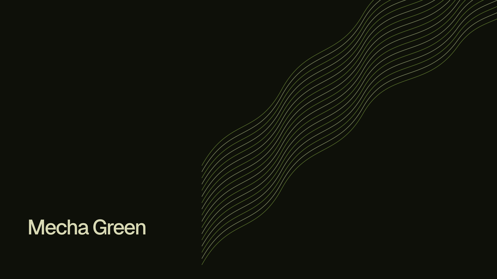
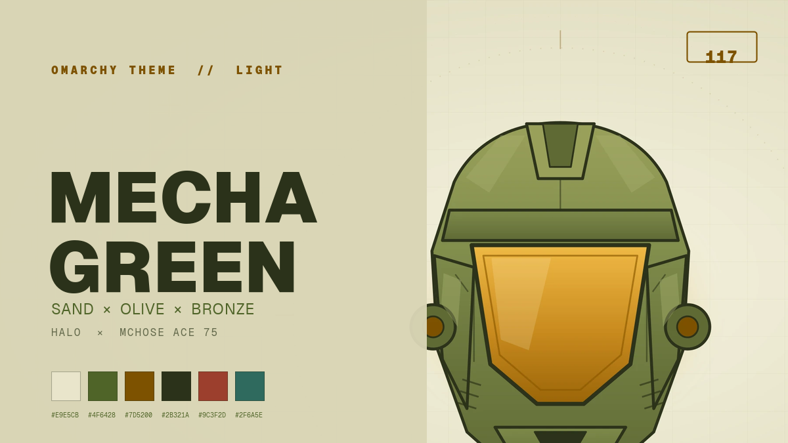
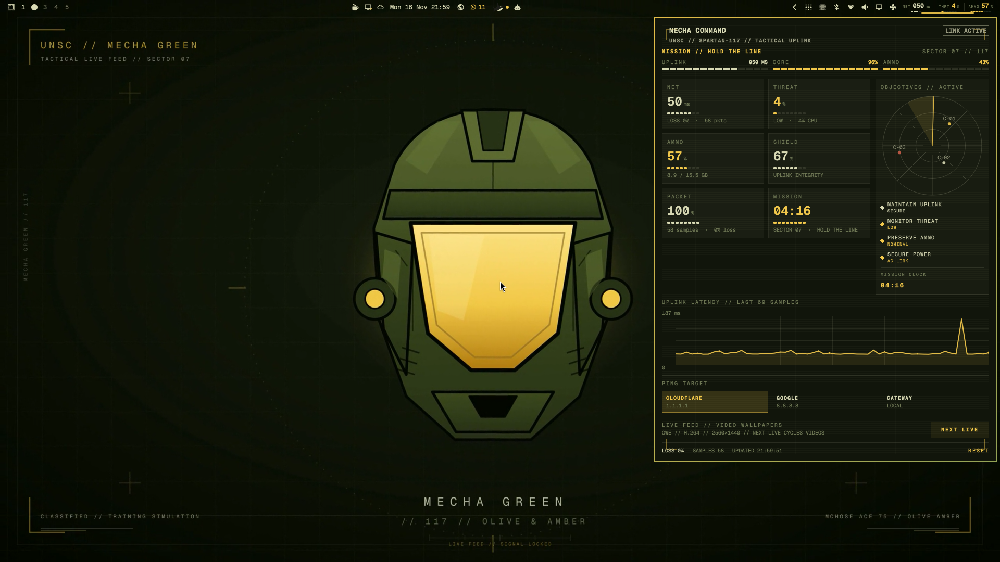
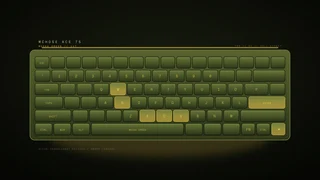
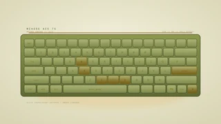
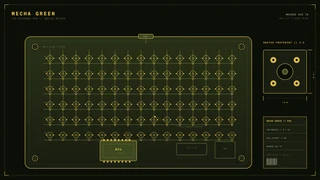
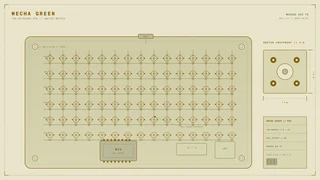
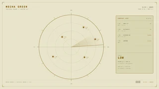
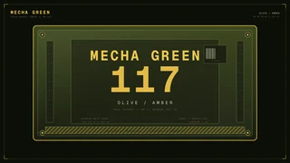
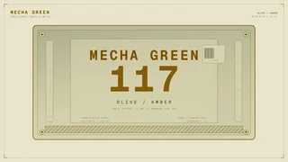

# Mecha Green for Omarchy

**Olive drab, worn steel and Master Chief's amber visor — a dark and a light
Omarchy theme tuned to sit next to an MCHOSE Ace 75 in Mecha Green.**

[](#license)
[](https://omarchy.org/)
[](https://quickshell.org/)
[](https://github.com/sazardev/omarchy-mecha-green/actions/workflows/validate.yml)




## What you get

- **Two complete themes** — `Mecha Green` (dark) and `Mecha Green Light`
  (sand/olive/bronze). Both drive the Omarchy shell, terminals, Neovim, VS
  Code, btop, tmux, gum, fcitx5, Chromium, icons and the Plymouth boot logo.
- **A themed appbar and shell** — `shell.toml` sets an olive-black bar with
  amber indicators, amber-tinted selection, gradient-bordered popups, menus,
  notifications, launcher and lock screen. The light theme flips it to sand
  and bronze.
- **15 dark wallpapers / 12 light wallpapers** — the repo bundles eight original
  Mecha Green pieces in each theme (helmet, topographic HUD, keyboard, switch
  blueprint, PCB blueprint, tactical radar, helmet schematic, supply crate).
  An optional fetcher adds seven dark and four light Halo scenes for personal
  use, curated to olive / amber / cream.
- **Mecha HUD** — a working Quickshell bar plugin: `NET` latency, `THRT` CPU
  load, `AMMO` RAM pressure, optional `PWR` battery. Click for a telemetry
  panel with a 60-sample latency graph, packet loss, uptime and a ping-target
  switcher.
- **Mecha NET** — a compact standalone latency widget if you want only ping.
- **CLI artifacts** — `mecha-status` prints a tactical dashboard in the
  terminal (`--json` and `--watch` included), and `ping-status` is a
  Waybar-style command-module script.
- **Original SVG sources** for the helmet, topographic and keyboard art.

## Install

### One command (recommended)

```sh
bash -c "$(curl -fsSL https://raw.githubusercontent.com/sazardev/omarchy-mecha-green/main/install.sh)"
```

The installer copies both themes, installs the plugins and CLI, enables the
Mecha HUD on the right side of the bar, and applies the dark theme. It does
**not** use `sudo` and backs up `shell.json` before touching the bar.

### From a clone

```sh
git clone https://github.com/sazardev/omarchy-mecha-green.git
cd omarchy-mecha-green
./install.sh
```

### Options

| Flag | What it does |
|---|---|
| `--light` | Apply **Mecha Green Light** instead of the dark theme |
| `--no-apply` | Install everything but keep the current theme |
| `--no-hud` | Do not enable the Mecha HUD bar widget |
| `--ping` | Also enable the standalone **Mecha NET** widget |
| `--halo` | Download the optional Halo wallpaper set (personal use only) |
| `--bar <mode>` | Bar background: `opaque` (default), `glassy` or `none` |
| `--no-bar` | Leave the current bar background mode alone |
| `--force` | Overwrite existing backgrounds and previews |
| `--dry-run` | Show what would be installed |

Examples:

```sh
./install.sh --light --halo
./install.sh --no-hud
./install.sh --ping --halo
```

> **Why not `omarchy theme install`?** This repository ships **two** themes plus
> plugins and a custom `hyprland.lua` / Alacritty config. Omarchy's repo-theme
> installer expects a single theme at the repository root and, by design, drops
> Lua and terminal files from cloned themes. `install.sh` copies the folders as
> user-owned themes, so everything works. The manual copy path is documented in
> [`docs/INSTALL.md`](docs/INSTALL.md).

### Requirements

- Omarchy with Hyprland + Quickshell (current Quattro).
- `git` or `curl` for the installer.
- `ping` from `iputils` for the NET/HUD widgets.
- ImageMagick (`magick`) only if you use `--halo` or
  `mecha-fetch-halo`.

## Use

```sh
omarchy theme set "Mecha Green"        # dark
omarchy theme set "Mecha Green Light"  # light
omarchy theme bg next                  # cycle the installed wallpapers

omarchy bar background opaque          # solid olive bar (the recommended look)
omarchy bar background glassy          # translucent
omarchy bar background none            # transparent, wallpaper only
```

The Mecha HUD is placed at the far right of the bar after `omarchy.power`:

```sh
omarchy plugin enable sazardev.mecha-hud --section right --after omarchy.power
```

Prefer only latency? Enable the compact NET widget:

```sh
omarchy plugin enable sazardev.ping --section right --after omarchy.network
```

## The Mecha HUD




The bar strip is three (or four) military readouts:

| Block | Meaning | Colour rule |
|---|---|---|
| `NET` | ICMP latency to the selected host | amber < 40 ms, sage < 100 ms, rust otherwise |
| `THRT` | CPU load | amber < 40%, sage < 70%, rust above |
| `AMMO` | RAM pressure, styled as ammunition | amber < 60%, sage < 85%, rust above |
| `PWR` | Battery percentage, shown only when a battery exists | amber charging, sage healthy, rust low |

Interactions:

- **Left click** — open the telemetry panel.
- **Middle click** — refresh every sample immediately.
- **Right click** — cycle the ping target: Cloudflare → Google → local gateway.
- Hover for a one-line tactical tooltip.

The panel adds:

- A 60-sample latency graph with packet-loss gaps.
- Per-sample packet loss and session sample count.
- CPU threat label (`LOW`, `GUARDED`, `ELEVATED`, `SEVERE`).
- RAM used / total in GB.
- Mission time (uptime) and a reset button.
- A ping-target switcher that persists your choice in `shell.json`.

Settings can also be changed from the shell:

```sh
omarchy bar set sazardev.mecha-hud pingHost 8.8.8.8
omarchy bar set sazardev.mecha-hud pingIntervalSec 5
```

Available keys: `pingHost` (string), `pingIntervalSec` (2–60), `showCpu`,
`showAmmo`, `showPower` (booleans).

## Tactical CLI

`mecha-status` is installed into `~/.local/bin`:

```sh
mecha-status                 # text HUD
mecha-status --json          # machine-readable
mecha-status --watch         # refresh every 2 s
mecha-status 8.8.8.8         # choose a ping host
```

```
  MECHA GREEN  //  TACTICAL STATUS  //  117
  ──────────────────────────────────────────────
  NET     045 ms    1.1.1.1
  THREAT    3 %      LOW
  AMMO     50 %      7.7 / 15.5 GB
  PWR     AC
  MISSION 0d 01:08
  LINK    192.168.1.254 via wlp7s0
  ──────────────────────────────────────────────
```

`ping-status` prints Waybar-style JSON for Omarchy's built-in
`type: "command"` bar modules. See [`docs/INSTALL.md`](docs/INSTALL.md#use-the-built-in-command-module)
for the `shell.json` snippet.

## Palette

### Mecha Green (dark)

| Role | Hex |
|---|---|
| Background | `#0E1009` |
| Raised surface | `#11150B` |
| Military olive | `#9DAE5C` |
| Visor amber / accent | `#F2C84B` |
| Sand text | `#D8D9B4` |
| Sage | `#BCC09A` |
| Rust | `#C85B47` |
| HUD teal | `#7FA89A` |

The Hyprland border is a 45° amber → olive → amber gradient.

### Mecha Green Light

| Role | Hex |
|---|---|
| Sand background | `#E9E5CB` |
| Raised surface | `#F1EEDA` |
| Olive | `#4F6428` |
| Bronze / accent | `#7D5200` |
| Dark olive ink | `#2B321A` |
| Rust | `#9C3F2D` |
| Deep patina | `#2F6A5E` |

## Bundled wallpapers

Each theme ships eight original 2560×1440 pieces. The optional Halo fetcher
adds seven dark and four light scenes on top.

| Art | Dark | Light |
|---|---|---|
| Helmet |  |  |
| Topographic HUD |  |  |
| Keyboard |  |  |
| Hall Effect switch |  |  |
| PCB / switch matrix |  |  |
| Tactical radar |  |  |
| Helmet schematic |  |  |
| Supply crate |  |  |

## Wallpapers & licensing

The repository bundles **original** wallpapers only:

- `8-mecha-helmet.webp` — original vector Spartan helmet.
- `9-topographic.webp` — original topographic HUD.
- `10-keyboard.webp` — original MCHOSE Ace 75-inspired keyboard art.
- `11-switch-blueprint.webp` — original Hall Effect switch cross-section.
- `12-pcb-blueprint.webp` — original 75% keyboard PCB / switch matrix.
- `13-radar.webp` — original tactical radar and contact list.
- `14-helmet-blueprint.webp` — original MJOLNIR helmet schematic.
- `15-crate.webp` — original field supply crate stencil.

These are licensed MIT together with the theme code.

The **Halo wallpaper set is not bundled**. It is Halo fan / © Microsoft–343
Industries artwork from Wallhaven, and remains the property of its respective
owners. The optional fetcher downloads and grades it for personal desktop use:

```sh
mecha-fetch-halo
# or
./scripts/fetch-halo-backgrounds.sh
```

It adds:

| File | Wallhaven | Credit |
|---|---|---|
| `1-master-chief.webp` | [85qdg2](https://wallhaven.cc/w/85qdg2) | NonoRiri |
| `2-amber-chief.webp` | [4x7leo](https://wallhaven.cc/w/4x7leo) | JT42 |
| `3-chief-dark.webp` | [3lovdd](https://wallhaven.cc/w/3lovdd) | SnackySkullFace |
| `4-night-ring.webp` | [9odk5d](https://wallhaven.cc/w/9odk5d) | ArtificialCC |
| `5-warthog.webp` | [5dy1j8](https://wallhaven.cc/w/5dy1j8) | CrisMaggot |
| `6-fireteam.webp` | [eo8ggr](https://wallhaven.cc/w/eo8ggr) | ZuaDoR0 |
| `7-canyon.webp` | [5wwdz7](https://wallhaven.cc/w/5wwdz7) | nativepixel |
| `1-warthog-light.webp` (light) | [5dy1j8](https://wallhaven.cc/w/5dy1j8) | CrisMaggot |
| `2-canyon-light.webp` (light) | [5wwdz7](https://wallhaven.cc/w/5wwdz7) | nativepixel |
| `3-desert-light.webp` (light) | [oxer87](https://wallhaven.cc/w/oxer87) | SamUerto |
| `4-jungle-light.webp` (light) | [zmreeg](https://wallhaven.cc/w/zmreeg) | SamUerto |

See [`docs/WALLPAPERS.md`](docs/WALLPAPERS.md) for the full credits and notes.

**Halo, Master Chief, MCHOSE and Omarchy are trademarks of their respective
owners. This is a personal fan theme, not affiliated with or endorsed by
Microsoft, 343 Industries, MCHOSE or Omarchy.**

## Customize

- Palette: edit `themes/mecha-green/colors.toml` (and the light twin), then
  `omarchy theme set "Mecha Green"` to regenerate the rest.
- Shell surfaces: edit `shell.toml` — bar background, sizes, selection,
  popups, notifications, launcher, lock, tooltips.
- Plugin: `omarchy bar set sazardev.mecha-hud <key> <value>`.
- More wallpapers: drop files into
  `~/.config/omarchy/themes/mecha-green/backgrounds/` and run
  `omarchy theme bg next`.
- The original SVG sources live in `assets/svg/` if you want to remix the
  backgrounds.

More in [`docs/CUSTOMIZE.md`](docs/CUSTOMIZE.md).

## Uninstall

```sh
./uninstall.sh
```

It removes both themes, both plugins and the CLI. Switch to another theme
before removing them.

## License

MIT for the theme configuration, plugins, scripts and original artwork. See
[`LICENSE`](LICENSE).

The Halo artwork is **not** included in the MIT grant and is never bundled in
this repository. If you fetch it, it is for personal desktop use only.

---

Made for Omarchy, olive keyboards and quiet amber HUDs.
