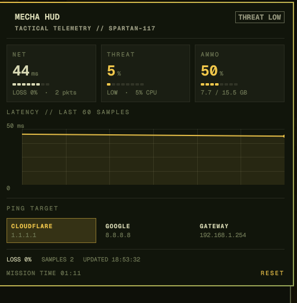

# Mecha HUD

A tactical status strip for the Omarchy bar: **NET** latency, **THRT** CPU
load, **AMMO** RAM pressure and optional **PWR** battery.



## Install

From the repository root:

```sh
cp -r plugins/sazardev.mecha-hud ~/.config/omarchy/plugins/
omarchy-shell shell rescanPlugins
omarchy plugin enable sazardev.mecha-hud --section right --after omarchy.power
```

The installer does this automatically unless you pass `--no-hud`.

## Interactions

| Action | Result |
|---|---|
| Left click | Open the telemetry panel |
| Middle click | Refresh NET, THRT, AMMO, PWR, uptime and gateway now |
| Right click | Cycle the ping target: Cloudflare → Google → gateway |
| Hover | Tactical one-line tooltip |

The panel has a 60-sample latency graph, packet-loss count, CPU threat label,
RAM used/total, mission time (uptime), ping-target switcher and a reset button.

## Settings

Change them from the shell or the bar UI:

```sh
omarchy bar set sazardev.mecha-hud pingHost 8.8.8.8
omarchy bar set sazardev.mecha-hud pingIntervalSec 5
omarchy bar set sazardev.mecha-hud showCpu true
```

| Key | Type | Default |
|---|---|---|
| `pingHost` | string | `1.1.1.1` |
| `pingIntervalSec` | integer (2–60) | `5` |
| `showCpu` | boolean | `true` |
| `showAmmo` | boolean | `true` |
| `showPower` | boolean | `true` (only renders with a battery) |

## Notes

- The ping host is passed as a separate `argv` element to `ping`, never
  interpolated into a shell string. The host is sanitized before use.
- CPU is computed from two `/proc/stat` samples; RAM from `/proc/meminfo`.
- The widget falls back to `PWR AC` on machines without a battery. On a
  desktop the `AMMO` RAM readout is the third block.
- Requires the Omarchy shell (Quickshell). It is a user plugin, so it survives
  Omarchy updates.
