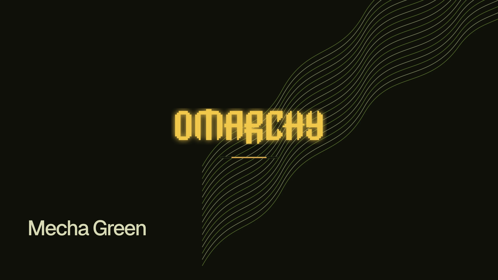

# Mecha Green Plymouth boot splash

A flat Plymouth theme using the desktop's topographic wave brand. It keeps the
amber Omarchy mark, progress bar and disk-encryption prompt, without the old
HUD rings, glow, gradients or microtext.



## Files

| File | Purpose |
|---|---|
| `mecha-green.plymouth` | Theme descriptor |
| `mecha-green.script` | Plymouth script (background, layout, progress) |
| `background.png` | 2560×1440 flat topographic brand background |
| `logo.png` | Amber Omarchy wordmark |
| `progress_box.png` / `progress_bar.png` | Amber-on-olive progress bar |
| `entry.png` / `lock.png` / `bullet.png` | Encryption password prompt |
| `preview.webp` | 2560×1440 design preview |

## Install

Run from the repository root:

```sh
sudo ./system/install-login.sh
```

The installer copies this directory to
`/usr/share/plymouth/themes/mecha-green`, sets it with
`plymouth-set-default-theme`, and rebuilds the initramfs. It applies on the
next boot.

Undo:

```sh
sudo ./system/uninstall-login.sh
```

## Notes

- The background is the same flat wave used by the dark desktop theme.
- The theme keeps the Omarchy Plymouth progress timing, display hotplug handling
  and encryption prompt behaviour.
- Regenerate the background and preview with `./scripts/render-system-assets.sh`.
