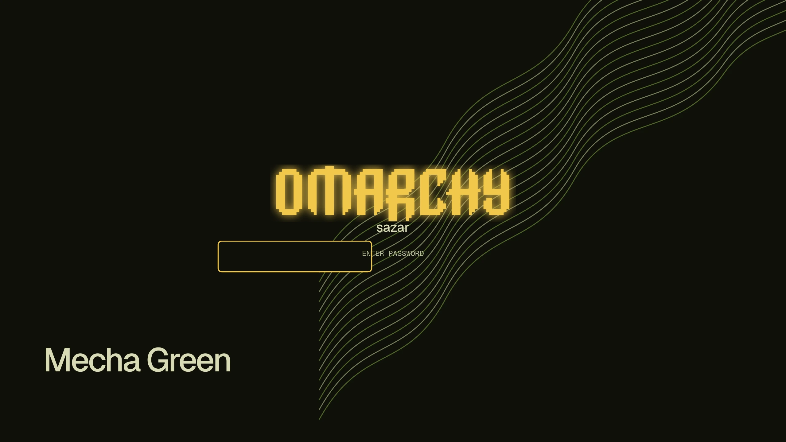

# Mecha Green login

A flat SDDM theme using the same topographic wave brand as the desktop. The
login keeps only the Omarchy mark, user selector and password field, with Geist
typography and no HUD, glow, gradients or shadows.



## Preview without logging out

```sh
sddm-greeter-qt6 --test-mode --theme system/sddm/mecha-green
```

## Install

Run the repository's login installer from a terminal with sudo access:

```sh
sudo ./system/install-login.sh
```

It copies this theme to `/usr/share/sddm/themes/mecha-green` and writes a
`99-zz-mecha-green.conf` SDDM drop-in. Existing SDDM configs are backed up.

To go back to the stock Omarchy login:

```sh
sudo rm /etc/sddm.conf.d/99-zz-mecha-green.conf
sudo systemctl restart sddm
```
